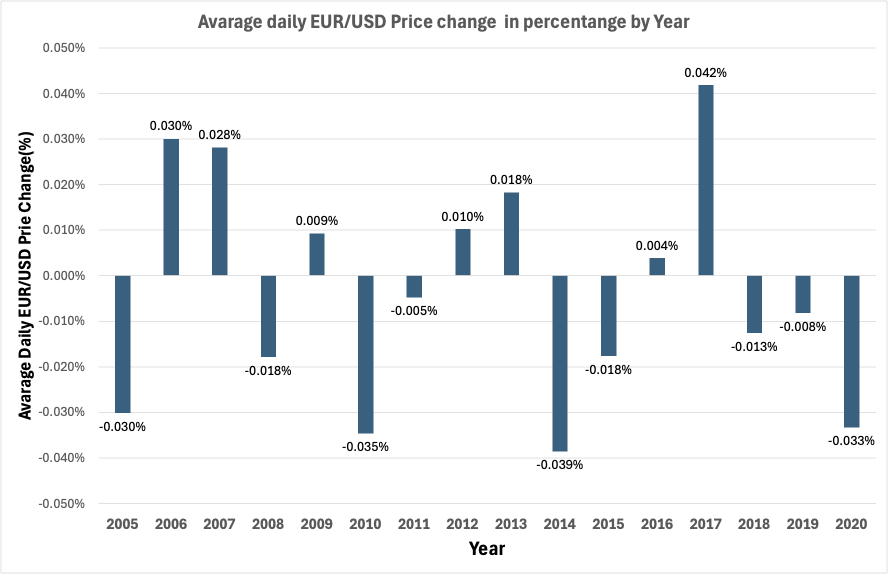
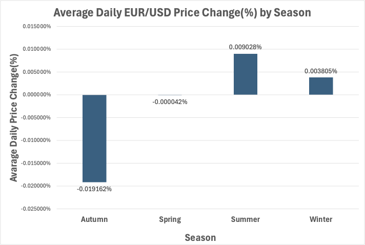
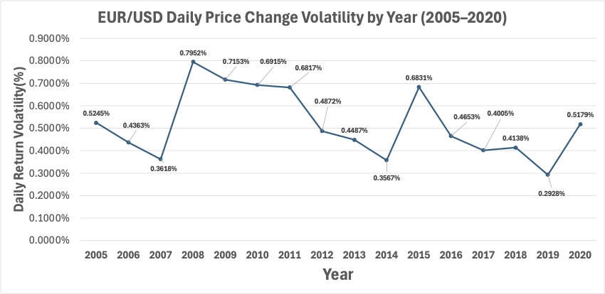

# EUR/USD Historical Exchange Rate Analysis (2005–2020)

## Project Overview

This project analyzes historical EUR/USD exchange rate data from 2005 to 2020 to identify price trends, seasonal patterns, monthly price movements, and volatility.

The analysis uses Python, Microsoft Excel, and SQLite to clean, explore, visualize, and analyze historical exchange rate data.

## Python Analysis

Python was used to clean, transform, explore, and visualize historical EUR/USD exchange rate data from 2005 to 2020.

### Data Preparation and Validation
- Loaded the original hourly dataset (`eurusd_hour.csv`) using Pandas.
- Aggregated hourly exchange rates into daily OHLC data.
- Created additional features, including price change, percentage change, year, month, season, and daily bid/ask price ranges.
- Checked data types, missing values, duplicate records, and date coverage.

### Exploratory Data Analysis
- Examined the overall EUR/USD exchange rate trend.
- Compared average daily bid price ranges across months and years.
- Identified the highest and lowest bid closing prices.
- Investigated seasonal price movements.
- Analyzed closing-price distributions and the frequency of daily price increases and decreases.

### Data Visualization
Created line charts, bar charts, a seasonal point plot, and a histogram using Matplotlib and Seaborn.

### Key Findings
- EUR/USD depreciated by approximately 15.4% over the analyzed period.
- The highest bid closing price was 1.5974 on 22 April 2008.
- The lowest bid closing price was 1.0390 on 20 December 2016.
- March had the highest average daily bid price range among months, while 2008 had the highest among years.
- Daily price increases and decreases were nearly balanced: 50.73% increasing days and 49.12% decreasing days.
- Seasonal price-change patterns varied across years.

### Python Project File
- `script.ipynb` — Complete Python notebook containing data preparation, exploratory analysis, visualizations, and findings.

## Excel Analysis

Microsoft Excel was used to analyze yearly and seasonal EUR/USD price movements and historical exchange rate volatility from 2005 to 2020.

### Data Analysis
- Used the cleaned EUR/USD dataset containing 4,672 daily records.
- Created Pivot Tables to calculate average daily percentage price changes by year.
- Compared average daily percentage price changes across the four seasons.
- Calculated yearly daily return volatility using standard deviation.
- Summarized the results in a dedicated Key Findings worksheet.

### Data Visualization
- Created bar charts to compare yearly and seasonal average daily price changes.
- Created a line chart to visualize changes in yearly volatility.

### Excel Analysis Charts

#### 1. Yearly Average Daily Price Change

#### 2. Seasonal Average Daily Price Change

#### 3. Yearly Daily Return Volatility

  

### Key Findings
- **2017:** Highest positive average daily percentage price change (+0.042%).
- **2014:** Most negative average daily percentage price change (-0.039%).
- **Summer:** Highest positive seasonal average daily percentage price change (+0.009028%).
- **Autumn:** Most negative seasonal average daily percentage price change (-0.019162%).
- **2008:** Highest daily return volatility (0.7952%).
- **2019:** Lowest daily return volatility (0.2928%).

### Excel Project File
- `EURUSD_Complete_Analysis.xlsx` — Excel workbook containing the cleaned dataset, yearly and seasonal analyses, Pivot Tables, charts, volatility calculations, and key findings.

## SQL Analysis (SQLite)

SQL was used to analyze historical EUR/USD exchange rate data from 2005 to 2020.

### Database Preparation
- Imported `cleaned_eurusd.csv` into SQLite as `eurusd_data`.
- Created a new table named `cleaned_eurusd_data` with appropriate data types.
- Transferred the imported data into the new table for analysis.

### Data Analysis
- Checked data quality, including missing values and duplicate dates.
- Analyzed yearly and monthly exchange rate performance.
- Identified periods with the highest price increases and decreases.
- Examined weekday price movements and volatility.
- Used SQL queries to identify historical market patterns.

### Key Findings
- **2017:** Highest annual price increase (+14.65%).
- **2014:** Largest annual price decrease (-11.97%).
- **December 2008:** Highest monthly price increase (+10.30%).
- **October 2008:** Largest monthly price decrease (-9.93%).
- **Thursday:** Highest average absolute daily price movement and volatility based on standard deviation.

### SQL Project Files
- `eurusd_analysis.db` — SQLite database containing the imported and prepared data.
- `eurusd_portfolio_final.sql` — Database preparation queries, SQL analysis and findings.

### How to Run
1. Download `eurusd_analysis.db` and `eurusd_portfolio_final.sql`.
2. Open the database using a SQLite-compatible tool.
3. Run the analysis queries in `eurusd_portfolio_final.sql`.

**Note:** The database preparation section documents how the analysis table was created. It should not be rerun on the provided database because the table already exists.

## Tableau Dashboard Analysis (2005–2020)

I created this interactive Tableau dashboard to tell a visual story of my EUR/USD historical data analysis from 2005 to 2020. The dashboard presents yearly and monthly bullish and bearish trading-day patterns, compares daily price-change volatility across weekdays, and explores the yearly distribution of daily price changes to understand how widely prices fluctuated and how stable or variable the market was over time.
### 1. Yearly Bullish vs Bearish Trading Days (2005–2020)

I calculated the number of bullish and bearish trading days for each year to show how often EUR/USD prices increased or decreased and to compare yearly trading-direction patterns.
### 2. Monthly Bullish vs Bearish Trading Days Heatmap (2005–2020)

I analyzed monthly bullish and bearish trading days to show how often EUR/USD prices increased or decreased within each month, helping the audience understand monthly trading-direction patterns.
### 3. Weekday Volatility Analysis (2005–2020)

I used the standard deviation of daily price changes to analyze EUR/USD volatility across different weekdays. The purpose was to compare price fluctuations and identify which weekdays experienced higher or lower volatility.
### 4. Yearly Price Change Distribution (2005–2020)

I analyzed the yearly distribution of daily EUR/USD price changes to understand how widely prices fluctuated within each year. The purpose was to compare the spread of daily price changes and identify years with higher or lower price variability.

**Data Limitation:** The dataset contains partial-year data for 2005 and 2020. Therefore, the annual bullish and bearish trading-day counts for these years are not directly comparable with those of complete years.

### Interactive Tableau Dashboard

[View the EUR/USD Historical Trading Analysis Dashboard on Tableau Public](https://public.tableau.com/app/profile/kazi.islam5244/viz/EURUSDHistoricalTradingAnalysis2005-2020/EURUSDHistoricalTradingAnalysis)